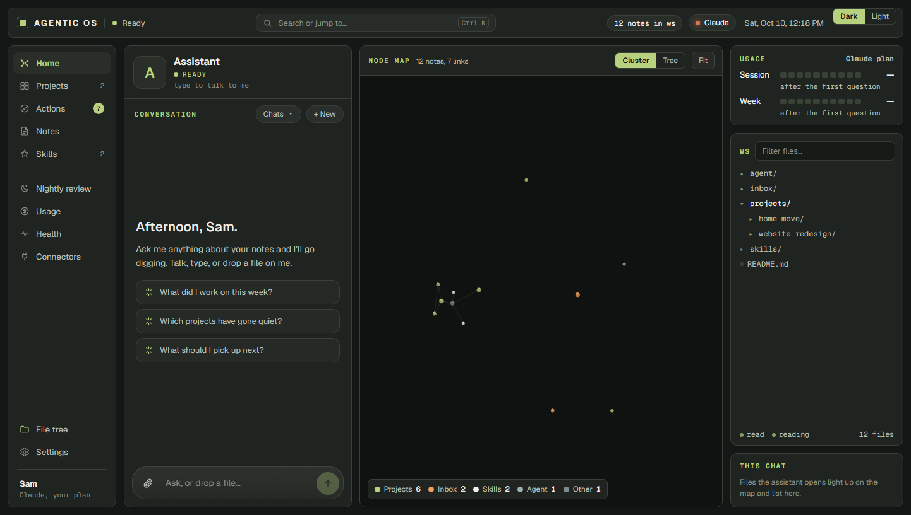
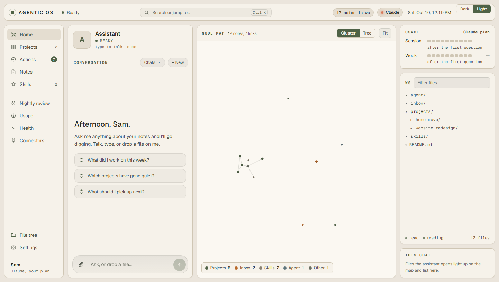
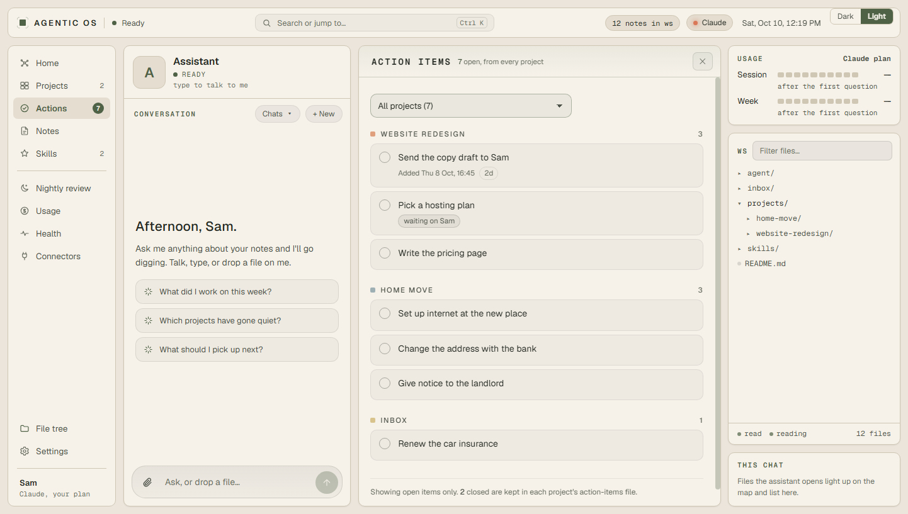

# Agentic OS

A desktop app for working with an AI assistant out of a folder of your own notes. Talk or type; watch it read and
edit your notes on a live node map; keep projects, notes and action items as plain markdown files you own.

It is meant as a **base to build on**: a working app with the safety rails, the file handling and the screens already
done, and nothing personal baked in. Name the assistant, give it a personality, restyle it, add pages.



| Light theme | Actions page |
|---|---|
|  |  |

## What it does

- **Chat with an assistant that works in your files.** It reads your notes to answer, and edits, creates and organises
  them when you ask. Several chats can run at once.
- **Asks before anything it can't undo.** Deleting what can't be backed up, force-pushing git, sending data off the PC,
  publishing online: each gets a yes/no card (with a "Question" button). Every ordinary edit is backed up first.
- **Node map.** Every note is a dot and every link a line, coloured by folder. The files the assistant reads light up
  as it works. Cluster or tree layout.
- **Projects, Notes, Actions.** One folder per project. A `notes.md` and an `action-items.md` in each one feed the
  Notes and Actions pages. See [Organising your files](docs/organising-your-files.md).
- **Skills.** Written-down ways of doing a kind of task (`skills/<name>/SKILL.md`), read before the task.
- **Any brain.** Claude (your plan or an API key), ChatGPT, Gemini, a local model (Ollama, LM Studio) or any
  OpenAI-style service.
- **Usage at a glance.** Your plan's session and week left (Claude), or spend against a budget (API keys).
- **Also:** voice in and out ("Hey computer", hold Space), Ctrl+K search, a nightly review with suggestions, connected
  apps (Gmail, Drive, GitHub, Chrome) loaded only when needed, a phone view, Discord approvals, dark and light themes.

## Get started

You need **Windows 10 or 11** and **Node.js 20 or newer** (https://nodejs.org).

```bash
git clone https://github.com/<you>/agentic-os.git
cd agentic-os
npm install
npm start
```

`npm start` builds the app and opens it. The welcome steps ask for:

1. **Your name and the assistant's name.**
2. **A brain.** For Claude on a Pro or Max plan, pick Claude, then "Sign in": a terminal opens Claude Code's own
   sign-in (type `/login`, finish in the browser). Or paste an API key. The app never sees your login.
3. **A workspace folder.** Pick a folder of notes you already have (an Obsidian vault works as it is), or press
   **"make a starter workspace"** to get a copy of [`example-workspace/`](example-workspace) in `Documents\Agentic OS`.
4. **Extras.** Shows whether voice is installed. It's optional; see [docs/voice.md](docs/voice.md).

Then ask it something, such as "What's open on the website project?"

## Organise your workspace

The short version (the full guide is [docs/organising-your-files.md](docs/organising-your-files.md)):

```
My workspace/
├── README.md               read by the assistant first
├── projects/
│   └── <project>/
│       ├── README.md
│       ├── notes.md        dated notes      -> Notes page
│       └── action-items.md "- [ ] ..." lines -> Actions page
├── inbox/                  notes.md and action-items.md for unfiled things
├── skills/<name>/SKILL.md  how to do a kind of task
└── agent/persona.md        the assistant's personality (yours to edit)
```

## Brains

| Brain | Sign in with | What you get |
|---|---|---|
| Claude | Claude Code sign-in (Pro or Max), or an API key | Everything: connected apps, helper agents, the plan meter |
| ChatGPT / OpenAI | OpenAI's Codex CLI, or an API key | Chat, files, edits with backups, yes/no cards, voice |
| Gemini | API key | Same as above |
| Antigravity | Google's Antigravity CLI (`agy`) | Chat and file work inside the CLI's own sandbox |
| On this PC | nothing (Ollama, LM Studio) | Same, with a local model that can use tools |
| Another provider | API key, any OpenAI-compatible address | Same |

On a ChatGPT or Google subscription the provider's own command line does the work inside its own sandbox, so the
app's yes/no cards and backups don't apply there. The Codex adapter has only been tested against a stand-in, not the
real CLI.

## More

- [Organising your files](docs/organising-your-files.md): projects, notes, action items, skills, persona
- [Voice](docs/voice.md): the optional speech tools and where to put them
- [Building on it](docs/building-on-it.md): where things live, how to change them, how to test

## Limits

- Windows only for now (the voice tools, the sign-in helper and the encryption of saved keys are Windows-specific).
- On a plan login, cost figures are API-price equivalents, not a bill.
- Use your own plan login for yourself only; check Anthropic's (or your provider's) terms before sharing a build that
  others sign in to.

## Licence

MIT. See [LICENSE](LICENSE).
