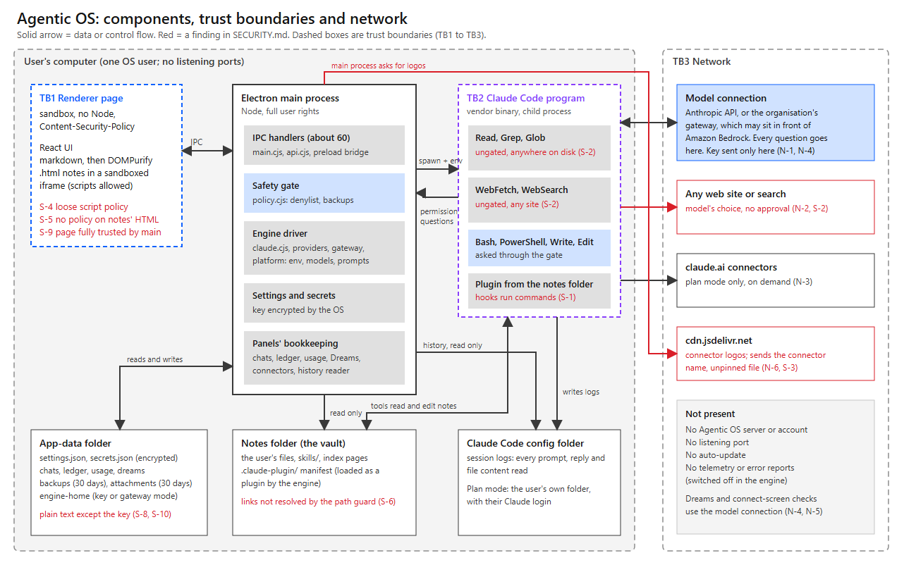
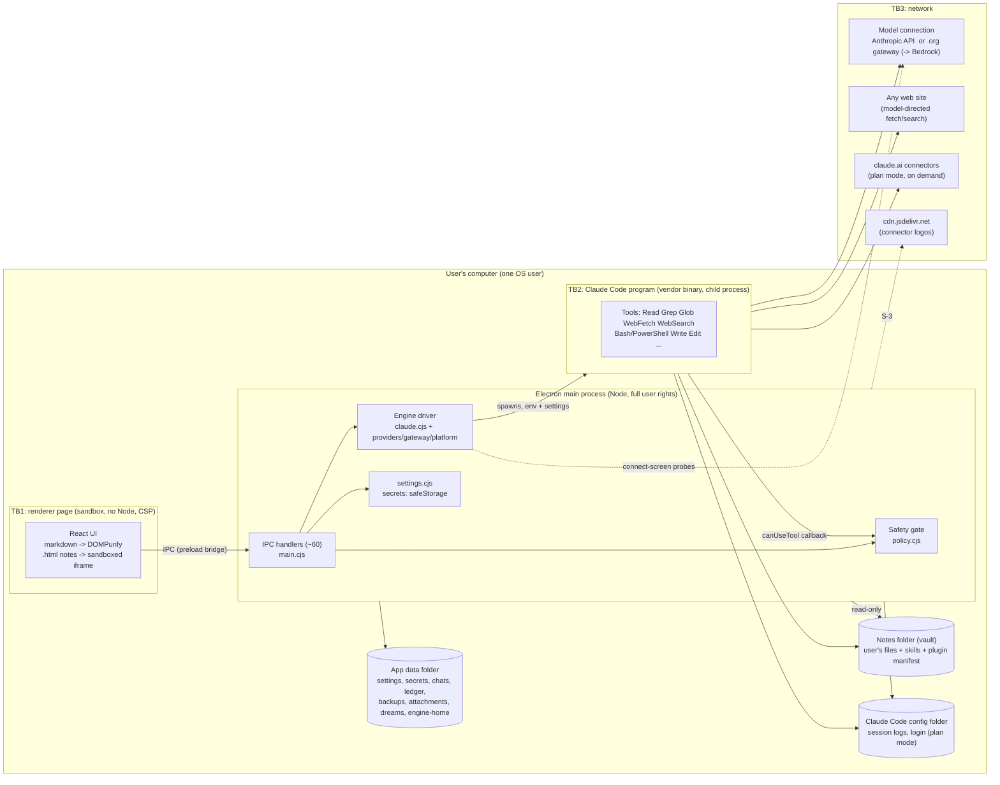

# Agentic OS: infrastructure and security map

> **v1.0 changes.** One IPC channel was added: `vault:reveal` calls Electron's `shell.showItemInFolder` on a path that must resolve inside the
> notes folder (a path outside it, or a missing one, is refused and returns false). The microphone and speech paths are no longer reachable from
> any screen, and the window sends the app a mute at start-up, so no spoken answers are made even if the optional voice tools are present.
> Usage and cost are no longer shown, but the ledger still records them locally (see DATA.md).

For a security review. It says what runs where, what talks to what, what crosses each trust boundary, what is stored and how it is
protected, and lists the weaknesses found while reading the code, each marked **verified** (shown by running it) or **read** (seen in
the code, not exercised). It was written from the code of 2026-10-06. Companions: [ARCHITECTURE.md](ARCHITECTURE.md),
[DATA.md](DATA.md).

**Not done and not claimed:** no penetration test, no network capture of a real session, no review of the Claude Code program itself
(a vendor binary), nothing run on a Mac.

---

## 1. Summary in ten lines

1. Agentic OS is a single-user desktop app (Electron). It runs **no server and opens no network port**.
2. All model traffic is made by the **Claude Code engine** (a vendor program Agentic OS starts), to the connection the user configured:
   Anthropic, or the organisation's **gateway** (Anthropic format or Amazon Bedrock format).
3. The page (UI) is sandboxed with no Node; it reaches the main process only through a fixed list of IPC calls (about 60).
4. The model can **read any file the user can** and **fetch any web page** without asking. Changes to files and commands go through a
   **denylist gate** that asks only for catastrophic actions and backs up what it deletes or overwrites.
5. Secrets (the key, extra gateway headers) are encrypted with the OS (Windows DPAPI / Mac Keychain through Electron `safeStorage`),
   never sent to the page. Everything else on disk (chats, ledger, backups, logs) is **plain text**.
6. With a key or gateway the engine runs with an **empty config folder** so a personal Claude login can never be sent to a gateway
   (verified; see section 7).
7. Nothing auto-updates; reporting, telemetry, surveys and update checks of the engine are switched off.
8. **Top findings:** S-1 a notes folder can run commands through plugin hooks, and the model can write such a file (verified);
   S-2 reading and web access are ungated, so prompt injection can exfiltrate; S-3 connector logos are fetched from a third-party CDN.
9. The gate is not a sandbox: any script the model writes and runs (Python, Node, PowerShell) can do anything the user can.
10. Unsigned builds; Mac untested.

## 2. Components and trust boundaries



The picture is `docs/img/architecture.png` (vector original: `docs/img/architecture.svg`, redrawn by `tools/make-diagram.cjs`). Red marks a
finding in section 9. The same map as text:

```text
 TB1 renderer page ──IPC──► Electron main process ──spawn + env──► TB2 Claude Code program ──► model connection (Anthropic or org gateway)
 (sandbox, no Node)         (Node, full rights)    ◄─permission──   (vendor binary)        ──► any web site (ungated)   ──► claude.ai connectors
                             │  gate: policy.cjs        questions    tools read/edit the ──► (plan mode, on demand)
                             │  key: OS safe storage                notes, write logs
                             ├──► app-data folder (settings, chats, ledger, backups, attachments, engine-home)
                             ├──► notes folder (read only here; edited by the tools after the gate)
                             ├──► Claude Code config folder (read only: history)
                             └──► cdn.jsdelivr.net (connector logos, S-3)
```

<details><summary>Same map as Mermaid source (for viewers that draw it)</summary>



</details>

Trust boundaries:

| ID | Boundary | What crosses | Enforced by |
|---|---|---|---|
| TB1 | page ↔ main process | IPC requests with plain data | `contextIsolation`, `sandbox`, no Node in the page, channel-name regex in `preload.cjs`, per-handler validation (uneven; see S-9) |
| TB2 | main ↔ Claude Code program | environment, SDK options, tool-permission callbacks | `canUseTool` → `policy.check`; `settingSources: []`; scrubbed env |
| TB3 | PC ↔ network | model requests, web fetches, probes | the user's connection choice; CSP in the page; engine telemetry switches |
| TB4 | **untrusted content ↔ the model** | notes, files, web pages, tool results enter the model's context | nothing technical. A folder whose README says `received: true` is only a marker (graph colour, Projects grouping); it is **not** enforced and the model is not told to distrust it |

## 3. Electron hardening in force

| Setting | Value | Where |
|---|---|---|
| `contextIsolation` | true | `main.cjs createWindow` |
| `nodeIntegration` | false | same |
| `sandbox` | true | same |
| `webSecurity` | default (on) | not overridden |
| Navigation | `will-navigate` to another URL is cancelled; `window.open` is denied and only `http(s)` URLs are handed to the default browser (`shell.openExternal`) | `main.cjs` |
| Permissions | the only permission granted is `media` (microphone), for this app's session | `setPermissionRequestHandler` |
| Content-Security-Policy | meta tag in `index.html` (section 4) | `index.html` |
| Custom protocols | `vault://` (files inside the notes folder), `models://` (one wake-word model file by base name) | `main.cjs` |
| Single instance | yes (not in test captures) | `requestSingleInstanceLock` |
| Remote debugging / devtools | not enabled by the app | — |
| Updates | none (no auto-updater); the Claude program is told never to update itself | `DISABLE_AUTOUPDATER` |
| Packaging | none signed; Mac packaging prepared, unverified | `package.json build` |

CSP (as written): `default-src 'self'; script-src 'self' 'unsafe-inline' 'unsafe-eval' 'wasm-unsafe-eval' blob:; worker-src 'self' blob:;
style-src 'self' 'unsafe-inline'; font-src 'self' data:; img-src 'self' data: vault:; frame-src 'self' vault:; media-src 'self' blob: data:;
object-src 'self' vault:; connect-src 'self' models: blob: data: ws://localhost:5180 http://localhost:5180`. The last two entries are the
Vite dev server. **No `https:` in `connect-src`**: page scripts cannot call out to the internet. Weak points: S-4.

## 4. Inbound surface

| Surface | Present? |
|---|---|
| Listening TCP/UDP ports | **none** (the earlier phone link and Discord link were removed; no `listen(` in the code) |
| Named pipes / local sockets | none by Agentic OS (the SDK talks to its child through pipes) |
| URL scheme / file associations | none registered |
| Second launch | brings the existing window forward |
| IPC from the page | the 60 channels in ARCHITECTURE.md section 6 |
| Files the app reads that others can influence | the notes folder; dropped attachments; `~/.claude/settings.json` (import, user-triggered); `.env` files (below) |

`.env` handling (`settings.envFile`): `ANTHROPIC_API_KEY` can be supplied by an environment variable or a `.env` file **next to the app
or in the app-data folder**. Whoever can write there can set the key Agentic OS uses (relevant for a shared install folder).

## 5. Outbound network map

| # | From | To | When | Carries | Controllable? |
|---|---|---|---|---|---|
| N-1 | Claude Code program | Anthropic API, or the gateway address (Bedrock path `/model/<id>/invoke[-with-response-stream]` or Anthropic path `/v1/messages`); also `GET /v1/models` (discovery), `GET /inference-profiles`, `HEAD /api/hello` | every question, and engine start | prompts, vault index pages (up to 6000 chars each), file contents the model reads, tool results, attachments' contents when read | the connection choice |
| N-2 | Claude Code program (`WebFetch`, `WebSearch`) | any site / search service | model's choice; **no approval** | whatever the model puts in the request | no switch in Agentic OS (S-2) |
| N-3 | Claude Code program | claude.ai connectors (Gmail, Drive, etc.) | plan mode only, after the model calls `use_connectors`; Connectors setting `Only when needed / Every chat / Never` | connector tool calls | yes (Connectors panel) |
| N-4 | main process | the gateway address, or `api.anthropic.com/v1/models` | when the user presses Check/Use, or applies an import | the key and extra headers (to that address only) | user-triggered |
| N-5 | engine via Dreams (`oneShot`) | the model connection (+ web search if the "web check" is on) | nightly at 2 am or on next launch if missed, or button | a weekly digest of questions and counts | yes (Dreams settings; web off by default) |
| N-6 | main process | `cdn.jsdelivr.net/npm/simple-icons@latest/icons/<name>.svg` | when the Connectors panel needs a logo not bundled | the connector's name | no switch (S-3) |
| N-7 | engine, plan mode | claude.ai for plan limits and connector discovery | at launch (no tokens), on Refresh | account identifiers (the engine's own) | n/a |
| N-8 | user's browser (via `shell.openExternal`) | `console.anthropic.com/settings/keys`; any link the user clicks in a note | user click | — | user |
| N-9 | page | `models://` and `vault://` (local files only) | always | — | local |

Switched off for the engine in every mode: `CLAUDE_CODE_DISABLE_NONESSENTIAL_TRAFFIC`, `DISABLE_TELEMETRY`, `DISABLE_ERROR_REPORTING`,
`DISABLE_FEEDBACK_COMMAND`, `CLAUDE_CODE_DISABLE_FEEDBACK_SURVEY`, `CLAUDE_CODE_DISABLE_OFFICIAL_MARKETPLACE_AUTOINSTALL`,
`DISABLE_AUTOUPDATER`; `skipWebFetchPreflight: true` (a fetch does not first ask Anthropic). **Checked on the engine's settings and on
the wire to a stand-in gateway (`npm run test:wire`), not by capturing a real session's traffic.**

## 6. Local process execution

| What | How started | Notes |
|---|---|---|
| Claude Code program | the Agent SDK, with the exact path from `platform.claudeExe()` | runs the model's tools; env from `claude.authEnv()` (contains the key as a variable) |
| Whatever the model runs (Bash/PowerShell/scripts) | the engine, after the gate | user's rights; see section 8 |
| Sign-in terminal | `cmd.exe /c start ... claude /login` (Windows) or `osascript` → Terminal (Mac) | env scrubbed of routing variables; the login itself is never seen by Agentic OS |
| Piper / whisper.cpp | `spawn`/`execFile` of programs in `tools/` | optional, not shipped, local only |
| Opening a file | `shell.openPath` (vault file in its default app); `shell.openExternal` (http/https only for links) | S-7 |

## 7. Secrets and credentials

| Secret | Stored | Protection | Reaches |
|---|---|---|---|
| Gateway/Anthropic key (`key:claude`) | `userData/secrets.json` | `safeStorage` (DPAPI / Keychain). **If encryption is unavailable it is stored as plain text** (S-8) | main process; the engine's environment; the connection it was issued for |
| Extra gateway headers (`headers:claude`) | same | same | the engine's `ANTHROPIC_CUSTOM_HEADERS`; probes |
| Legacy `discord:*` | same | same | nothing (dead feature) |
| The user's Claude login (plan mode) | in the **Claude Code config folder**, owned by the engine, not Agentic OS | engine's own | the engine only |
| `~/.claude/settings.json` values | read once on import (user-triggered, read-only); key kept in memory until confirm | file untouched | saved into `key:claude` |

Controls: the page receives only `{saved, tail}` hints (last 4 characters); import descriptions omit the key and header values; test
output masks credentials; Agentic OS never writes the key to logs or the ledger.

**Verified credential isolation (wire test):** with a Claude login present on the PC, an Anthropic-format gateway received that login's
OAuth token instead of the gateway key, until the engine was given its own empty config folder. In key/gateway modes
`CLAUDE_CONFIG_DIR=<userData>/engine-home`; in plan mode the normal folder is used. Also `ROUTING_VARS` (Anthropic, AWS Bedrock, Vertex,
Foundry, model-pin, region, cert variables) are deleted from the engine's inherited environment before the assistant's own are set.

## 8. Authorisation model for the model's actions

- **Ungated (always allowed):** `Read`, `Grep`, `Glob`, `WebSearch`, `WebFetch`, `TodoWrite`, and the assistant's own `window`, `open_file`,
  `use_connectors`, `request_model`, `request_helpers` tools. `Read`/`Glob`/`Grep` are **not confined to the notes folder** (the engine
  runs as the user; `additionalDirectories` merely adds the backup and attachment folders).
- **Gated (`policy.check`):** every other tool. Edits and overwrites run unasked with a backup copy first (asked only for system
  folders). Shell commands run unasked unless they match a **denylist** of catastrophic patterns (format/erase disk, git history
  destruction, delete accounts/registry/services, upload by command, publish or delete online, `rm -rf /` or `~`, `sudo`, `diskutil
  erase`, `dd of=/dev`, `csrutil`, `chmod -R /`) or are a delete the backup logic cannot cover.
- **Not a sandbox:** the denylist cannot see what a script does. `python -c`, `node -e`, a downloaded program, `curl` GET with data in
  the URL, `PowerShell` one-liners and so on are not blocked. This follows the product rule "do everything unless it is hard to undo",
  not a security boundary.
- **Helpers (subagents)** use the same gate and the same ungated read/web tools; the `Agent` tool is allowed only after the user says yes to
  `request_helpers` and only as `scout` (read/search/web, Haiku) or `worker` (can edit/run, Sonnet).
- **Persona instruction** tells the model to say what an action will do before an asked action, and to drop an action the user refuses.
- **Skills and instructions** loaded from the notes folder are trusted text (section 9, S-1).

## 9. Findings

Severity is a judgement for a single-user desktop tool that holds company material. "Verified" means demonstrated by running it here.

### S-1 High, verified: a notes folder can run commands, and the model can write one
`claude.cjs` loads the notes folder as an engine plugin (`plugins: [{type:'local', path: vault.ROOT}]`, needed for skills). A plugin may
carry **hooks** that run shell commands. Test: a folder with `.claude-plugin/plugin.json` and `hooks/hooks.json` (`UserPromptSubmit` and
`SessionStart` command hooks) caused the command to run when the engine started with the assistant's options (a marker file appeared). Hooks are
not tool calls, so they **bypass the safety gate and its cards**.
Consequences: (a) opening an untrusted notes folder that contains a plugin manifest (any folder made from `starter/` has one) runs
that folder's hooks; (b) because ordinary edits inside the vault run unasked, a **prompt-injected model could write `hooks/hooks.json`**
(or an `.mcp.json`, a `commands/` or `agents/` file, or a skill with hooks in its frontmatter) and have it execute on the next engine
start or prompt.
Options (not implemented): treat writes to `.claude-plugin/`, `hooks/`, `.mcp.json`, `commands/`, `agents/` as gated; load skills from a
read-only copy that contains only `skills/*/SKILL.md` with hooks stripped; test whether engine setting `disableAllHooks` disables
plugin hooks without disabling the assistant's own SDK hooks; warn when a chosen notes folder already contains hooks.

### S-2 Medium-High, read: no barrier between reading and sending
Unrestricted `Read` plus ungated `WebFetch`/`WebSearch` means a prompt-injected model (injection via a note, a web page, an attachment or
a connector result) can read any file the user can (for example `~/.ssh`, browser profiles, other documents) and put it in a URL or search.
The `curl -X POST`-style pattern in the denylist does not cover GET requests or scripts. Options: confine `Read`/`Grep`/`Glob` to the
vault, attachments and backups with permission rules or a path check in `canUseTool`; make `WebFetch` ask once per domain per chat;
switch web tools off by a setting (the persona already says the web is a last resort).

### S-3 Medium-Low, verified in code: third-party request for connector logos
`connectors.cjs logo()` requests `https://cdn.jsdelivr.net/npm/simple-icons@latest/icons/<connector>.svg`. It reveals the names of the
connected apps to a CDN and pulls an **unpinned** (`@latest`) file, which is saved to `userData/connector-logos` and shown through
`` (images do not run script). It is the only request in Agentic OS that is not the model connection, a user-triggered check
or a browser link. Fix: ship logos in `public/connectors` only, or pin a version and add a setting.

### S-4 Medium-Low, read: weak Content-Security-Policy
`script-src` allows `'unsafe-inline'` and `'unsafe-eval'` (the latter probably for the WebAssembly wake-word library; **not verified** that it is
needed). With no `https:` in `connect-src` an injected script still cannot call out, but it could drive the IPC bridge (S-9). Try removing
`'unsafe-eval'`/`'unsafe-inline'` and, if voice needs eval, load voice code on demand under a separate policy.

### S-5 Medium-Low, read: scripts in notes' HTML files
`.html` notes render in `<iframe sandbox="allow-scripts" src="vault://...">`. The frame is cross-origin with no bridge access, but the
`vault://` response has **no CSP header of its own**, so scripts inside the file can load remote images/scripts or call out, for example a
beacon when a received client file is merely viewed. Fix: add a restrictive `Content-Security-Policy` header to `vault://` responses for HTML
(`default-src 'none'; img-src data: vault:; style-src 'unsafe-inline'`), or drop `allow-scripts`.

### S-6 Medium-Low, read: path guard ignores links
`vault.resolveInside` compares resolved path strings. A symlink or Windows junction **inside** the notes folder pointing outside is
followed by `vault://`, `vault:read` and the file viewer. Fix: compare `fs.realpathSync` results.

### S-7 Medium-Low, read: "Open in its own app" can run a file
`vault:openExternal` → `shell.openPath` opens any vault file with its default handler; for `.exe .bat .cmd .ps1 .lnk .js .vbs .sh .command .app`
that **executes** it. It is a click away in the viewer for non-previewable files. Fix: refuse executable extensions or reveal the file in the file manager.

### S-8 Medium-Low, read: plain-text secret fallback and `.env`
`settings.setSecret` stores the value as `{plain: ...}` when `safeStorage` is unavailable. `.env` next to the app or in the data folder is
honoured for `ANTHROPIC_API_KEY`. Fix: refuse to save when encryption is unavailable (say so in the screen); document `.env` as developer-only.

### S-9 Medium-Low, read: the page is fully trusted by the main process
Any script running in the page can call every IPC channel, e.g. `setup:set` with any existing folder as the notes folder followed by
`vault:read` (arbitrary file read), `providers:save`, `brain:send` with attachments' paths filtered by `attachments.isMine`. Defences are
DOMPurify, the sandbox and the CSP (S-4/S-5 weaken them). Fix: check `event.senderFrame.url` in `api.handle`; set the notes folder only
from the main-process folder dialog; validate inputs per handler.

### S-10 Medium, read: data at rest is not encrypted
Only secrets are encrypted. Chats, ledger, dreams (digests of questions), backups (full copies of files before edits), attachments,
and the Claude Code session logs (every prompt and file content read) are plain files. The app-data folder is `%APPDATA%\Agentic OS` (`%APPDATA%` is the **roaming**
profile folder, which can follow the user between machines on a managed Windows setup) or `~/Library/Application Support/Agentic OS` on a Mac; the default notes folder is `Documents\Agentic OS Notes`, which
may be synced by OneDrive or iCloud. Full-disk encryption is assumed. See DATA.md for the inventory and retention.

### S-11 Low, read: supply chain and signing
Dependencies (production): `@anthropic-ai/claude-agent-sdk` (plus the platform program package), `@modelcontextprotocol/sdk`, `zod`, `react`,
`react-dom`, `three`, `3d-force-graph`, `marked`, `dompurify`, `vosk-browser`, `@fontsource/ibm-plex-*`. Dev: `electron` 44, `vite`,
`typescript`, `electron-builder`. `npm audit` reports 2 moderate advisories, both from `vosk-browser` → `uuid` (no fix available). Builds
are unsigned; there is no update channel, so fixes reach people only by re-installing. The Claude program is a vendor binary run with the user's rights.

### S-12 Low, not tested: microphone permission
The session grants `media` to any frame that asks (`perm === 'media'`). The vault iframe is cross-origin without an `allow` attribute,
so the browser's Permissions Policy should refuse it, but this was not tested.

### S-13 Information: other items
- The engine's own connectivity checks to the gateway base URL (`HEAD /api/hello`) and model discovery appear in the gateway's logs.
- The model's persona and method text, the user's first name (if given), and every vault `index.md` are sent in the system prompt each session.
- Claude.ai connectors (plan mode) give the model access to the user's connected apps on demand; default is "Only when needed".
- Dead code: Discord/import stand-ins and their IPC handlers (`discord:set` can still write a secret that nothing reads).

## 10. Controls that work, and how they were checked

| Control | Check |
|---|---|
| No credential in the page | `test-v2.cjs` (hint only; import never shows key/header values) |
| Key header, pinned model, no AWS signing, no probes | `test-wire.cjs` against a stand-in gateway, both formats |
| Personal login not sent to a gateway | `test-wire.cjs` (engine-home isolation; verified failing before the fix) |
| Safety gate rules (Windows and pretend-Mac) | `test-policy.cjs` (28 checks) |
| Backups before edits/deletes | `test-policy.cjs` (queued backups, `backupAny`) |
| Real settings file untouched by import | `test-v2.cjs` hash check |
| No listening ports | code search (`listen(` absent); not a port scan |
| Telemetry/update switches | environment asserted in `test-v2.cjs`; traffic not captured |
| Graph/animation idle | `test-graph.cjs` |

## 11. Recommended order of work

1. S-1 (plugin hooks), because it is the only verified route to code execution outside the gate.
2. S-2 (confine reads, gate web fetch) and S-7 (no executing opened files).
3. S-3 (remove the CDN), S-5 (CSP on `vault://`), S-6 (real paths).
4. S-8 (refuse plain-text secret), S-9 (sender checks, folder only from dialog), S-4 (CSP).
5. Network capture of a real session through the real gateway to confirm section 5 is complete; Mac run; code signing.
